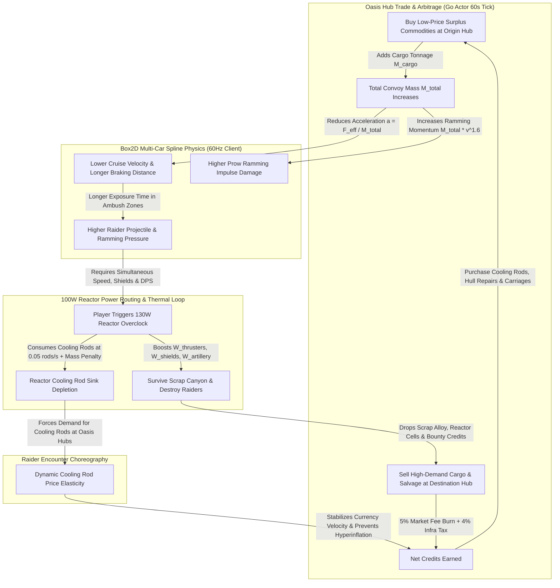

# Chrono-Convoy: Iron Drift — Sprint 1 Game Design Document (GDD)

- **Document Version:** `1.0.0-sprint1`
- **Canonical Config Schema:** `/workspace/chrono-convoy-iron-drift/docs/design/convoy_config.json` (mirrored to `/workspace/chrono-convoy-iron-drift/client/assets/config/convoy_config.json`)
- **Monte Carlo Economy Simulator:** `/workspace/chrono-convoy-iron-drift/docs/design/Oasis_Economy_Simulation.py`
- **Simulation Verification Output:** `/workspace/chrono-convoy-iron-drift/docs/design/economy_simulation_results.json`
- **ClickUp Tickets Covered:**
  - `[DES-01] Chrono-Convoy Sprint 1 Core Loop & Parametric JSON Schema` (`z8rctemh4j`) — **Critical Path**
  - `[DES-02] Oasis Hub Dynamic Arbitrage & Reactor Cooling Rod Sink Model` (`z8rctemh4n`)
- **Owner:** @Droplet (Game Designer)

---

## 1. High-Concept & Design Pillars

### 1.1 High-Concept Pitch
**Chrono-Convoy: Iron Drift** is a real-time tactical armored-train action-roguelite and asynchronous Oasis arbitrage simulator built on LibGDX (Box2D + Scene2D + 3D API) and a Go Fiber / Actor Model backend. Players command the **Iron Drifter Mk.I**, a multi-car nuclear-powered sand-locomotive hurtling across procedural Catmull-Rom spline rail networks through scorched desert basins, dynamically routing **100 Watts** of reactor output across **Shields**, **Artillery**, and **Thrusters** while hauling physicalized commodity tonnages between three player-influenced **Oasis Hubs**.

### 1.2 Core Design Pillars & Ludonarrative Resonance
1. **Unforgiving Momentum (Mass Is Fate):** Every ton of cargo or armor bolted onto the train physically alters its Box2D inertia, hill-climbing grade drag, braking distance, and ramming impulse. Profit literally weighs down your survival.
2. **Zero-Sum Reactor Triage (100W Power Routing):** The player cannot max out defense, firepower, and speed simultaneously under nominal operation. Routing watts to **Thrusters** to climb a canyon grade starves **Shields** and **Artillery** unless the player burns scarce **Reactor Cooling Rods** to enter a 130W Overclock state.
3. **Thermodynamic Economy & Arbitrage Sinks:** Currency inflation is prevented by tying high-margin trade runs and high-threat combat directly to **Reactor Cooling Rod** depletion, hull repair costs, and 60-second Go Actor supply/demand elasticity across the three Oasis Hubs.
4. **Diegetic Tactical Clarity (Cognitive Load Budget):** Working memory is preserved by consolidating train telemetry into an industrial engineer control deck (@Mochi) and velocity-synced BPM audio stems (@Echo) so players feel reactor strain and speed changes without taking their eyes off the combat space.

---

## 2. Core Gameplay Loop & Macro-System Interdependence

### 2.1 Macro-System Causal Loop Diagram (Mermaid)

### 2.2 Positive (Amplifying) vs. Negative (Stabilizing) Feedback Loops
| Loop Name | Polarity | System Path | Design Intent |
| :--- | :---: | :--- | :--- |
| **Heavy Haul Profit Loop** | **Positive (+)** | Higher Credits $\rightarrow$ Buy Heavy High-Margin Promethium/Cells $\rightarrow$ Higher Arbitrage Revenue $\rightarrow$ Buy Foundry Smelter Car $\rightarrow$ More Cargo Capacity | Drives extrinsic progression and mid-run wealth compounding. |
| **Inertia & Thermal Drag Loop** | **Negative (-)** | Higher Cargo Mass ($M_{\text{cargo}}$) $\rightarrow$ Lower Acceleration ($a$) & Longer Climb Time $\rightarrow$ More Combat Exposure & Overclock Rod Burn $\rightarrow$ Higher Repair & Cooling Rod Sinks | Prevents risk-free max-capacity hauling; forces players to balance tonnage against route threat. |
| **Go Actor Price Dampening Loop** | **Negative (-)** | Repeated Player Arbitrage on Route $A \rightarrow B$ $\rightarrow$ Origin Stock Drops & Destination Stock Rises $\rightarrow$ 60s Actor Tick Narrows Spread & Mean-Reverts | Eliminates static single-route farming and incentivizes triangular 3-Hub rotation. |

---

## 3. Mathematical Models & Parametric Physics Specifications (`[DES-01]`)

All constants below are parameterized in `/workspace/chrono-convoy-iron-drift/docs/design/convoy_config.json` (and `/workspace/chrono-convoy-iron-drift/client/assets/config/convoy_config.json`).

### 3.1 Total Convoy Mass & Box2D Multi-Car Coupler Kinematics
For a locomotive of dry mass $M_{\text{loco}} = 25,000\text{ kg}$ towing $N \in [1, 4]$ carriages:

$$M_{\text{total}} = M_{\text{loco}} + \sum_{i=1}^{N} \left( M_{\text{car,dry}, i} + M_{\text{cargo}, i} \right)$$

Each carriage is linked via a Box2D `RevoluteDistanceHybrid` coupler joint with:
- **Spring Frequency:** $f = 8.5\text{ Hz}$
- **Damping Ratio:** $\zeta = 0.82$ (critically damped to prevent snake-whip oscillation on tight Catmull-Rom bends)
- **Angular Limit:** $\pm 24.0^\circ$
- **Coupler Break Force:** $F_{\text{break}} = 650,000\text{ N}$

### 3.2 Tractive Effort, Acceleration & Grade Drag Curve
Net tangential acceleration $a(t)$ along the centripetal Catmull-Rom spline tangent $\hat{\mathbf{t}}$ is:

$$a(t) = \frac{F_{\text{pull,base}} \cdot M_{\text{thrust}}(W_{\text{thrusters}}) - F_{\text{rolling}} - F_{\text{aero}} - F_{\text{grade}}}{M_{\text{total}}}$$

Where:
- $F_{\text{pull,base}} = 180,000\text{ N}$ (up to $288,000\text{ N}$ at $W_{\text{thrusters}} = 60\text{ W}$)
- $F_{\text{rolling}} = \mu \cdot M_{\text{total}} \cdot g \cdot \cos(\theta)$, with $\mu = 0.018$, $g = 9.81\text{ m/s}^2$
- $F_{\text{aero}} = \frac{1}{2} \rho C_d A v^2 \approx 0.65 \cdot v^2\text{ (kN scaled)}$
- $F_{\text{grade}} = M_{\text{total}} \cdot g \cdot \sin(\theta)$, where $\theta \in [-9.5^\circ, +9.5^\circ]$ is local spline pitch

### 3.3 Braking Distance & Ramming Impulse Equations
- **Braking Distance ($d_{\text{brake}}$):**
  $$d_{\text{brake}}(v, M_{\text{total}}) = \frac{v^2}{2 \cdot (F_{\text{brake}} / M_{\text{total}})} \cdot \left[ 1 + k_{\text{inertia}} \left( \frac{M_{\text{cargo,total}}}{M_{\text{loco}}} \right)^\beta \right]$$
  With $F_{\text{brake}} = 220,000\text{ N}$, $k_{\text{inertia}} = 0.42$, and $\beta = 1.15$. Because track switches require a commit decision $180\text{ m}$ before the fork node, an overloaded train traveling at $35\text{ m/s}$ cannot brake in time if the player delays switching.

- **Ramming Impulse Damage ($D_{\text{ram}}$):**
  $$D_{\text{ram}} = k_{\text{ram}} \cdot \left(\frac{M_{\text{total}}}{1000}\right) \cdot \left( v_{\text{rel}} \right)^\alpha \cdot M_{\text{prow}}$$
  With $k_{\text{ram}} = 0.55$, $\alpha = 1.60$, $M_{\text{prow}} = 1.35$, and self-recoil damage ratio $= 0.18$ (mitigated by active shields).

### 3.4 Reactor 100W Power Routing & Subsystem Scaling Curves
Under normal operation, the reactor supplies $W_{\text{pool}} = 100\text{ W}$ allocated in $5\text{ W}$ steps across three subsystems ($W_s \in [0, 60\text{ W}]$, $\sum W_s \le W_{\text{pool}}$):

| Subsystem | Allocation Range | Scaling Equations | Gameplay Effect at $0\text{ W}$ / $35\text{ W}$ (Optimal) / $60\text{ W}$ (Max) |
| :--- | :---: | :--- | :--- |
| **Shields** ($W_{\text{sh}}$) | $0 - 60\text{ W}$ | $R_{\text{sh}} = 18.0 \cdot \left(\frac{W_{\text{sh}} + 5}{40}\right)^{1.25}$ $\text{Mitigation} = \min(0.75, 0.15 + 0.01 W_{\text{sh}})$ | **0W:** $1.3\text{ HP/s}$ regen, $15\%$ mitigation **35W:** $18.0\text{ HP/s}$ regen, $50\%$ mitigation **60W:** $33.0\text{ HP/s}$ regen, $75\%$ mitigation |
| **Artillery** ($W_{\text{art}}$) | $0 - 60\text{ W}$ | $M_{\text{rof}} = 0.50 + 0.018 W_{\text{art}} + 0.00012 W_{\text{art}}^2$ $M_{\text{dmg}} = 0.75 + 0.010 W_{\text{art}}$ $M_{\text{vel}} = 0.85 + 0.006 W_{\text{art}}$ | **0W:** $0.50\times$ RoF, $0.75\times$ Dmg ($0.375\times$ DPS) **35W:** $1.28\times$ RoF, $1.10\times$ Dmg ($1.41\times$ DPS) **60W:** $2.01\times$ RoF, $1.35\times$ Dmg ($2.72\times$ DPS) |
| **Thrusters** ($W_{\text{thr}}$) | $0 - 60\text{ W}$ | $M_{\text{thrust}} = 0.60 + 0.0167 W_{\text{thr}}$ $M_{\text{speed}} = 0.70 + 0.0125 W_{\text{thr}}$ | **0W:** $0.60\times$ Pull Force, $19.6\text{ m/s}$ top speed **35W:** $1.18\times$ Pull Force, $31.9\text{ m/s}$ top speed **60W:** $1.60\times$ Pull Force, $38.0\text{ m/s}$ top speed |

### 3.5 Overclocking & Thermal Shutdown State Machine
- **Activating Overclock:** Injecting a **Reactor Cooling Rod** expands $W_{\text{pool}}$ from $100\text{ W} \rightarrow 130\text{ W}$ for $20.0\text{ s}$ (`cooling_rod_burn_rate_per_sec = 0.05`).
- **Thermal Accumulation:** While $W_{\text{allocated}} > 100\text{ W}$, core heat $H \in [0, 100]$ rises at:
  $$\frac{dH}{dt} = 6.5 \cdot \text{AmbientHeatMod} - 3.2\text{ heat/sec}$$
- **Emergency Coolant Flush:** Consuming an extra Cooling Rod immediately drops $H$ by $-45.0$.
- **Thermal Shutdown ($H \ge 100.0$):** Triggers a mandatory $5.0\text{ s}$ SCRAM lockout where available power drops to $30\text{ W}$ emergency backup ($10\text{ W}$ per subsystem), leaving the convoy vulnerable to raider boarding and ramming.

### 3.6 Sprint 1 Carriages, Turrets & Raider Archetypes

#### Attachable Carriages (`max_carriage_slots = 4`)
| Carriage ID | Dry Mass (kg) | Max Cargo (kg) | Hull HP | Armor | Mounted Weapon / Special Passive | Cost (Cr) |
| :--- | :---: | :---: | :---: | :---: | :--- | :---: |
| `gatling_turret_car` | $8,500$ | $2,000$ | $650$ | $18$ | Mounts `gatling_turret` (360° anti-skiff sweep) | $450$ |
| `shield_dome_car` | $9,200$ | $1,500$ | $700$ | $22$ | Mounts `arc_harpooneer` + $+350\text{ HP}$ ($26\text{ m}$) dome | $580$ |
| `cargo_smelter_car` | $11,000$ | $12,000$ | $850$ | $20$ | Passively refines raw scrap $\rightarrow 1.35\times$ Alloy value | $520$ |
| `artillery_mortar_car` | $12,500$ | $2,500$ | $750$ | $24$ | Mounts `heavy_artillery` ($140\text{ m}$ siege AoE) | $680$ |

#### Turret Weapons
| Turret ID | Base Damage | Cooldown (ms) | Base RoF (RPS) | Range (m) | Splash (m) | Ammo Scrap Cost | Optimal Watts | Overclock DPS Mult |
| :--- | :---: | :---: | :---: | :---: | :---: | :---: | :---: | :---: |
| `gatling_turret` | $18.0$ | $125$ | $8.000$ | $65.0$ | $0.0$ | $0.25$ / burst | $20\text{ W}$ | $1.45\times$ |
| `heavy_artillery` | $165.0$ | $2,200$ | $0.455$ | $140.0$ | $8.5$ | $3.50$ / shot | $35\text{ W}$ | $1.60\times$ |
| `arc_harpooneer` | $75.0$ | $1,600$ | $0.625$ | $55.0$ | $2.5$ | $2.00$ / shot | $25\text{ W}$ | $1.50\times$ |

#### Raider Enemy Archetypes
| Raider ID | Role | Mass (kg) | Max Speed (m/s) | HP | Armor | Threat Weight | Bounty (Cr) | Primary Behavior & Combat Role |
| :--- | :--- | :---: | :---: | :---: | :---: | :---: | :---: | :--- |
| `sand_skiff_flanker` | Flanker / Harasser | $1,850$ | $36.0$ | $220$ | $6$ | $1.0$ | $35$ | Orbits at $28\text{ m}$, strafes rear cargo cars, forces `gatling_turret` tracking. |
| `iron_rammer_brute` | Heavy Rammer | $9,400$ | $31.5$ | $680$ | $22$ | $2.6$ | $90$ | Intercepts couplers at $4\text{ m}$ with $1.55\times$ ram impulse; countered by `arc_harpooneer` tether slow ($45\%$) + `heavy_artillery`. |
| `dune_mortar_buggy` | Ranged Artillery Anchor | $3,600$ | $30.0$ | $340$ | $10$ | $1.8$ | $60$ | Holds at $85\text{ m}$ lobbing $6\text{ m}$ AoE shells ahead of spline path; forces speed modulation or long-range counter-battery fire. |

---

## 4. Encounter Choreography, Spline Track & Pacing Wave Curve

### 4.1 Procedural Centripetal Catmull-Rom Track Topology
- Each inter-hub sector consists of **24 spline segments** ($120\text{ m}$ per segment $= 2,880\text{ m}$ total run length).
- **Track Switch Forks** occur every **6 segments** ($720\text{ m}$), giving players a $180\text{ m}$ lookahead signposted by architectural lighting and environmental silhouettes:
  - **High-Threat Branch (`high_threat_scrap_canyon`):** Narrow rusted gorge with $8.5^\circ$ grade climbs, $1.65\times$ threat weight, $1.48\times$ salvage reward multiplier, $+20\%$ Cooling Rod drop bonus, and $1.15\times$ ambient heat accumulation.
  - **Low-Yield Branch (`low_yield_salt_flats`):** Wide flat alkali basin with $2.0^\circ$ max grade, $0.75\times$ threat weight, $0.85\times$ salvage reward multiplier, and $0.85\times$ ambient heat modifier (ideal when heavily loaded with fragile cargo or low on Cooling Rods).

### 4.2 Sector Pacing & Intensity Wave Curve (24 Segments / ~240 Seconds)
| Segments | Phase Name | Target Intensity ($0-10$) | Spawns & Choreography | Player Cognitive Focus |
| :--- | :--- | :---: | :--- | :--- |
| **1 – 4** | Departure & Cruise Trim | $2 / 10$ | $2\times$ `sand_skiff_flanker` scouts | Feel cargo mass inertia; trim baseline 100W allocation. |
| **5 – 6** | **Fork 1 Decision Approach** | $5 / 10$ | $1\times$ `dune_mortar_buggy` + $2\times$ Skiffs | Inspect Cooling Rod stock & hull HP; switch rail lever before $180\text{ m}$ commit line. |
| **7 – 11** | Mid-Sector Ambush Wave 1 | $8 / 10$ | $1\times$ `iron_rammer_brute` + $3\times$ Skiffs + $1\times$ Buggy | Overclock to 130W; harpoon the Rammer Brute before coupler impact; collect salvage crates. |
| **12 – 14** | Canyon Vista / Smelting Lull | $3 / 10$ | Non-combat salvage wreckage + **Fork 2 Decision** | Vent reactor heat; let `cargo_smelter_car` refine scrap into alloy; prepare for climax wave. |
| **15 – 20** | Climax Siege Gauntlet | $9.5 / 10$ | $2\times$ `iron_rammer_brute` (pincer) + $2\times$ `dune_mortar_buggy` + $3\times$ Skiffs | Full toolkit triage: emergency coolant flush, alternating Shield/Artillery surges, ramming weak skiffs off the rails. |
| **21 – 24** | Oasis Hub Shield Perimeter | $1 / 10$ | Oasis automated rail-cannons clear stragglers; deceleration into Hub | High-relief tension release; inspect arbitrage ticker and dock at Oasis market. |

---

## 5. Virtual Economy Architecture & Reactor Cooling Rod Sink Model (`[DES-02]`)

### 5.1 Three Oasis Hubs & Structural Supply/Demand Matrix
@Patrick's Go backend runs an Actor supervision tree where each Oasis Hub is an independent state actor ticking every **60 seconds** (`actor_tick_interval_sec = 60`). Each hub has asymmetric production and demand multipliers across the **5 commodities**, creating natural triangular arbitrage loops:

| Commodity (`id`) | Unit Mass (kg) | Base Price (Cr) | Min / Max Bounds (Cr) | Elasticity ($\alpha$) | Reversion ($\gamma$) | **Hydro-Haven** (Prod / Dem) | **Iron-Refinery** (Prod / Dem) | **Aether-Spire** (Prod / Dem) |
| :--- | :---: | :---: | :---: | :---: | :---: | :---: | :---: | :---: |
| `purified_water` | $50$ | $40$ | $18 - 95$ | $0.42$ | $0.18$ | **$1.85\times$** / $0.60\times$ *(Surplus)* | $0.55\times$ / **$1.65\times$** *(Deficit)* | $0.70\times$ / $1.40\times$ |
| `scrap_alloy` | $80$ | $55$ | $25 - 125$ | $0.38$ | $0.20$ | $0.90\times$ / $1.35\times$ | **$1.90\times$** / $0.60\times$ *(Surplus)* | $0.75\times$ / **$1.50\times$** *(Deficit)* |
| `crude_promethium` | $110$ | $120$ | $55 - 275$ | $0.50$ | $0.16$ | $0.65\times$ / $1.45\times$ | **$1.60\times$** / $0.75\times$ *(Surplus)* | $0.80\times$ / **$1.55\times$** *(Deficit)* |
| `reactor_cells` | $65$ | $185$ | $90 - 410$ | $0.55$ | $0.15$ | $0.80\times$ / $1.25\times$ | $0.85\times$ / **$1.40\times$** *(Deficit)* | **$1.80\times$** / $0.65\times$ *(Surplus)* |
| `cooling_rods` | $45$ | $95$ | $50 - 240$ | $0.60$ | $0.14$ | $1.20\times$ / $0.95\times$ | $0.70\times$ / **$1.55\times$** *(Deficit)* | **$1.65\times$** / $0.75\times$ *(Surplus)* |

**Primary Triangular Arbitrage Cycle:**
1. **Hydro-Haven $\rightarrow$ Iron-Refinery:** Haul cheap **Purified Water** ($\sim 33\text{ Cr} \rightarrow \sim 49\text{ Cr}$).
2. **Iron-Refinery $\rightarrow$ Aether-Spire:** Haul heavy **Scrap Alloy** & **Crude Promethium** ($\sim 103\text{ Cr} \rightarrow \sim 150\text{ Cr}$).
3. **Aether-Spire $\rightarrow$ Hydro-Haven / Iron-Refinery:** Haul high-tech **Reactor Cells** ($\sim 145\text{ Cr} \rightarrow \sim 222\text{ Cr}$) and restock **Reactor Cooling Rods** at Aether-Spire's surplus discount before re-entering the volcanic Iron-Refinery canyons.

### 5.2 Go Actor 60-Second Price Update Equation
At every 60-second tick $t \rightarrow t+1$, each Oasis Hub actor updates stock $S_{h,c}(t+1)$ and price $P_{h,c}(t+1)$ deterministically (with bounded Gaussian market microstructure noise $\epsilon$):

$$S_{h,c}(t+1) = \text{clamp}\Big( S_{h,c}(t) + 0.25(R_{\text{prod}} - R_{\text{dem}}) + \Delta Q_{\text{player}} + 0.18(S_{\text{eq}} - S_{h,c}(t)),\; 0.20 S_{\text{eq}},\; 2.50 S_{\text{eq}} \Big)$$

$$P_{\text{target}} = P_{\text{base},c} \cdot \left( 1 + \alpha_c \cdot \frac{D_{\text{eff}} - S_{h,c}(t+1)}{S_{\text{eq}}} \right)$$

$$P_{h,c}(t+1) = \text{clamp}\Big( P_{h,c}(t) + 0.45\big(P_{\text{target}} - P_{h,c}(t)\big) + \gamma_c\big(P_{\text{base},c} - P_{h,c}(t)\big) + \epsilon,\; P_{\min,c},\; P_{\max,c} \Big)$$

### 5.3 Reactor Cooling Rod Sink Decay Model
To prevent runaway wealth accumulation as players unlock high-margin arbitrage routes, **Reactor Cooling Rods** act as a dynamic, physics-coupled currency sink:

$$\text{Rods}_{\text{consumed/sector}} = R_{\text{baseline}} + R_{\text{overclock}}(\text{Branch}) + k_{\text{thermal}} \cdot \left(\frac{M_{\text{cargo}}}{10,000\text{ kg}}\right)$$

- $R_{\text{baseline}} = 2.15\text{ rods/sector}$ (mandatory core thermal regulation during transit)
- $R_{\text{overclock}} = 3.15\text{ rods/sector}$ in High-Threat Scrap Canyon ($0.85\text{ rods/sector}$ on Salt Flats)
- $k_{\text{thermal}} = 1.28\text{ rods per } 10\text{ metric tons}$ of hauled cargo
- Effective Credit Sink per Sector:
  $$\text{Sink}_{\text{rods}} = \max\big(0.5,\; \text{Rods}_{\text{consumed}} - 0.35 \cdot \text{Rods}_{\text{looted}}\big) \times P_{\text{hub,cooling\_rods}}(t) \times 1.32_{\text{wear\_mult}}$$

### 5.4 Verified 1,000-Run Monte Carlo Simulation Results
Executed via `/workspace/chrono-convoy-iron-drift/docs/design/Oasis_Economy_Simulation.py` (`seed = 42069`, $N = 1,000$ runs, $60$ Actor ticks / $15$ sector hauls per run; full JSON output in `economy_simulation_results.json`):

| Economy Metric (60-Tick / 1-Hour Session) | p10 | p50 (Median) | Mean | p90 | Std Dev | Target / Guardrail | Status |
| :--- | :---: | :---: | :---: | :---: | :---: | :---: | :---: |
| **Total Faucets Generated (Cr/hr)** | $15,507.2$ | **$20,757.5$** | $20,877.0$ | $26,198.6$ | $4,078.6$ | $15\text{k} - 28\text{k}\text{ Cr/hr}$ | **PASS** |
| **Total Sinks Destroyed (Cr/hr)** | $14,916.5$ | **$17,333.5$** | $17,396.3$ | $20,015.5$ | $1,984.7$ | $14\text{k} - 22\text{k}\text{ Cr/hr}$ | **PASS** |
| **Net Currency Velocity (Cr/hr)** | $+338.0$ | **$+3,465.0$** | $+3,480.7$ | $+6,498.0$ | $2,390.4$ | $+500 - +6,500\text{ Cr/hr}$ | **PASS** |
| **Sink-to-Faucet Ratio ($S / F$)** | $0.747$ | **$0.833$** | $0.851$ | $0.977$ | $0.091$ | **$[0.780, 0.940]$** | **VERIFIED** |
| **60-Tick Inflation Index ($I_{60}$)** | $1.0200$ | **$1.0280$** | $1.0277$ | $1.0350$ | $0.0058$ | **$[0.9000, 1.1000]$** | **VERIFIED** |
| **Cooling Rods Burned / Run (rods)** | $58.80$ | **$65.02$** | $65.09$ | $71.65$ | $5.04$ | $55 - 75\text{ rods/hr}$ | **PASS** |
| **Cooling Rod Share of Total Sinks** | $38.7\%$ | **$43.7\%$** | $43.8\%$ | $49.0\%$ | $3.9\%$ | $35\% - 50\%$ | **PASS** |

#### Faucet & Sink Attribution Breakdown (Mean across 1,000 Runs)
- **Faucets ($20,877.00\text{ Cr/hr}$):**
  - Combat Salvage Sales (`scrap_alloy`, `reactor_cells`): **$10,199.02\text{ Cr}$ ($48.9\%$)**
  - Oasis Hub Commodity Arbitrage Net Margin: **$7,181.90\text{ Cr}$ ($34.4\%$)**
  - Raider Kill Bounties: **$3,496.08\text{ Cr}$ ($16.7\%$)**
- **Sinks ($17,396.34\text{ Cr/hr}$):**
  - Reactor Cooling Rod Burn & Wear Decay: **$7,568.99\text{ Cr}$ ($43.5\%$)**
  - Convoy Hull & Armor Repair ($1.55\text{ Cr/HP}$): **$3,329.73\text{ Cr}$ ($19.1\%$)**
  - Oasis Infrastructure Tax ($4\%$), Emergency Coolant Flush & Upkeep: **$2,460.17\text{ Cr}$ ($14.1\%$)**
  - 5% Hub Market Buy/Sell Transaction Fee Burn: **$2,230.88\text{ Cr}$ ($12.8\%$)**
  - Turret Ammo Fabrication Cost: **$1,806.57\text{ Cr}$ ($10.4\%$)**

---

## 6. Cross-Discipline Engineering & Art Handoff Checklist

| Discipline & Owner | Ticket(s) | Handoff Contract from `convoy_config.json` & GDD |
| :--- | :--- | :--- |
| **Client (@Jack)** | `CLI-01`, `CLI-02` | Load `/workspace/chrono-convoy-iron-drift/client/assets/config/convoy_config.json` at startup. Bind `locomotive`, `mass_to_momentum_curves`, `reactor`, `carriages`, `turrets`, and `spline_track` directly to Box2D `RevoluteDistanceHybrid` joints and the 60Hz `ReactorPowerController`. |
| **Backend (@Patrick)** | `BE-01`, `BE-02` | Load `/workspace/chrono-convoy-iron-drift/docs/design/convoy_config.json` (or mirror). Use `economy.oasis_hubs`, `economy.commodities`, and the 60s Actor price formula in §5.2. Enforce ACID ledger bounds (`min_price`, `max_price`, `market_transaction_fee_pct = 0.05`) and validate replay run checksums against `cooling_rod_sink_model`. |
| **3D Art (@Onigiri)** | `3D-01` | Match bounding footprints in `locomotive.dimensions_m` ($14.0 \times 4.2 \times 4.8\text{ m}$) and `carriages[].length_m` ($10.5 - 12.0\text{ m}$), rail gauge $3.2\text{ m}$ (`track_width_m = 6.5`), and turret socket pivots for `gatling_turret`, `heavy_artillery`, and `arc_harpooneer`. |
| **2D / UI (@Mochi)** | `UI-01` | Build Scene2D Engineer Control Deck around the 3-channel `5W`-stepped 100W Reactor allocator (`shields`, `artillery`, `thrusters`), Overclock 130W toggle + Cooling Rod counter, and thermal gauge warning at `75.0` / SCRAM lockout at `100.0`. |
| **Audio (@Echo)** | `AUD-01` | Drive industrial soundtrack stem crossfades and BPM scaling via normalized train velocity $v / v_{\max} \in [0, 1]$ ($6.0\text{ m/s}$ cruise to $38.0\text{ m/s}$ overclock) and trigger alarm stems when reactor heat $H \ge 75.0$. |
| **QA (@Aegis)** | `QA-01` | Assert JSON schema parity between `docs/design/convoy_config.json` and `client/assets/config/convoy_config.json`; assert $\sum W_s \le 100\text{ W}$ (or $\le 130\text{ W}$ during active Cooling Rod burn); assert Sink-to-Faucet p50 $\in [0.78, 0.94]$ and 60-tick Inflation Index p90 $\le 1.10$. |
